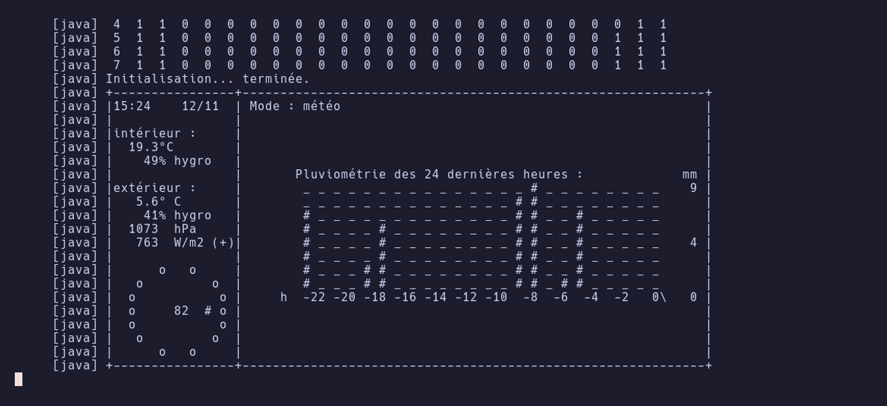

# Odomo

[English Version](README.md)



Odomo est une application de terminal domotique et de surveillance météorologique basée sur Java. Elle affiche des données météo en temps réel (température intérieure/extérieure, humidité, pression atmosphérique, ensoleillement, vitesse et direction du vent) et l'état du chauffage via une interface ASCII textuelle.

## Prérequis

- Java JDK (Java 17 ou supérieur recommandé)
- Apache Ant

## Comment Compiler & Exécuter

### Utilisation d'Apache Ant

1. **Compiler le projet :**
   ```bash
   ant compile
   ```

2. **Lancer l'application :**
   ```bash
   ant run
   ```

### Compilation & Exécution Manuelle

1. Compiler les fichiers sources :
   ```bash
   javac -d build/classes src/odomo/*.java
   ```

2. Lancer l'application :
   ```bash
   java -cp build/classes odomo.Odomo
   ```

## Comment Utiliser

Lorsque vous lancez Odomo, une interface interactive s'affiche avec l'écran d'état présentant les mesures actuelles des capteurs et un graphique/histogramme textuel.

À l'invite `Action : `, saisissez l'une des commandes suivantes (un seul caractère) :

- **A** : Afficher l'aide.
- **M** ou **P** : Passer en mode Météo (affiche l'histogramme des précipitations/pluviométrie sur 24 heures).
- **T** : Passer en mode Météo affichant l'histogramme de température des 60 dernières minutes.
- **C** : Passer en mode Chauffage.
- **N** : Modifier les plages horaires de chauffage (saisie du programme de chauffage en mode Normal).
- **Q** : Quitter l'application.

## Implémentation Technique

- **Modélisation par Matrices 2D** : Stocke les historiques des capteurs par heure/minute (pluviométrie sur 24h, températures sur 60m) et les programmes de chauffage hebdomadaires (matrices d'états booléens `7 × 24`).
- **Moteur de Rendu ASCII Dynamique** : Construit une grille de caractères (`char[][]`) combinant une boussole (rose des vents) en direct et des histogrammes mis à l'échelle dynamiquement, sans bibliothèques TUI externes.
- **Structure Modulaire** : Sépare la simulation des capteurs et la gestion des données (`Meteo`, `Chauffage`) des entrées/sorties console et du formatage d'écran (`Odomo`, `Ecran`).

## Structure du Projet

```text
├── src/odomo/         # Classes Java principales (boucle principale, logique météo/chauffage)
├── test/              # Suites de tests JUnit validant les mises à jour de matrices
├── img/demo.gif       # Animation de démonstration du terminal
└── build.xml          # Configuration de build Apache Ant
```

