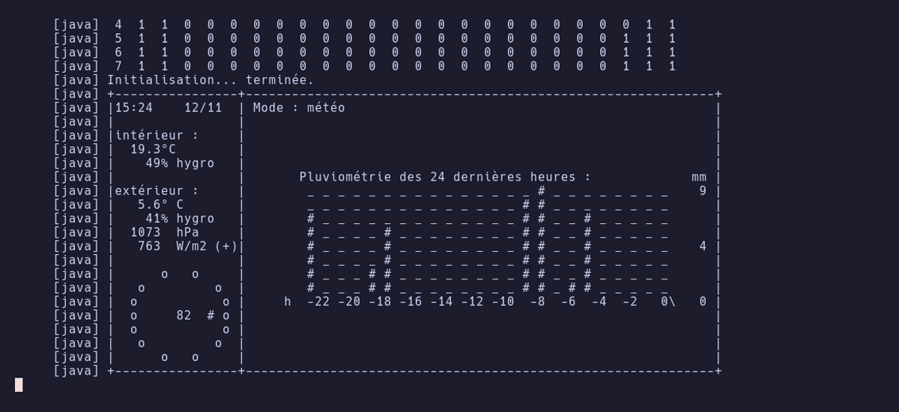

# Odomo

[Version Française](README.fr.md)



Odomo is a Java-based home automation and weather monitoring terminal application. It displays real-time weather data (indoor/outdoor temperature, humidity, atmospheric pressure, sunshine, wind speed and direction) and heating status in a text-based ASCII interface.

## Requirements

- Java JDK (Java 17 or higher recommended)
- Apache Ant

## How to Compile & Run

### Using Apache Ant

1. **Compile the project:**
   ```bash
   ant compile
   ```

2. **Run the application:**
   ```bash
   ant run
   ```

### Manual Compilation & Execution

1. Compile source files:
   ```bash
   javac -d build/classes src/odomo/*.java
   ```

2. Run the application:
   ```bash
   java -cp build/classes odomo.Odomo
   ```

## How to Use

When you launch Odomo, an interactive terminal interface displays the status screen with current sensor metrics and a text-based graph/histogram. 

At the `Action : ` prompt, enter one of the following single-character commands:

- **A** : Show help instructions.
- **M** or **P** : Switch to Weather mode (displays 24-hour precipitation/pluviometry histogram).
- **T** : Switch to Weather mode displaying the temperature histogram for the last 60 minutes.
- **C** : Switch to Heating mode.
- **N** : Modify heating time slots (Normal mode heating schedule entry).
- **Q** : Quit the application.

## Technical Implementation

- **2D Matrix Data Modeling**: Stores hourly/minute-by-minute sensor histories (pluviometry over 24h, temperatures over 60m) and weekly heating schedules (`7 × 24` boolean/state matrices).
- **Dynamic ASCII Rendering Engine**: Builds a character-buffer grid (`char[][]`) combining a live wind-rose compass and dynamically scaled histograms without external TUI libraries.
- **Modular Structure**: Separates sensor simulation/data management (`Meteo`, `Chauffage`) from console I/O and screen formatting (`Odomo`, `Ecran`).

## Project Structure

```text
├── src/odomo/         # Core Java classes (main loop, weather/heating logic, ASCII screen builder)
├── test/              # JUnit test suites validating matrix updates and histogram scaling
├── img/demo.gif       # Terminal demo animation
└── build.xml          # Apache Ant build configuration
